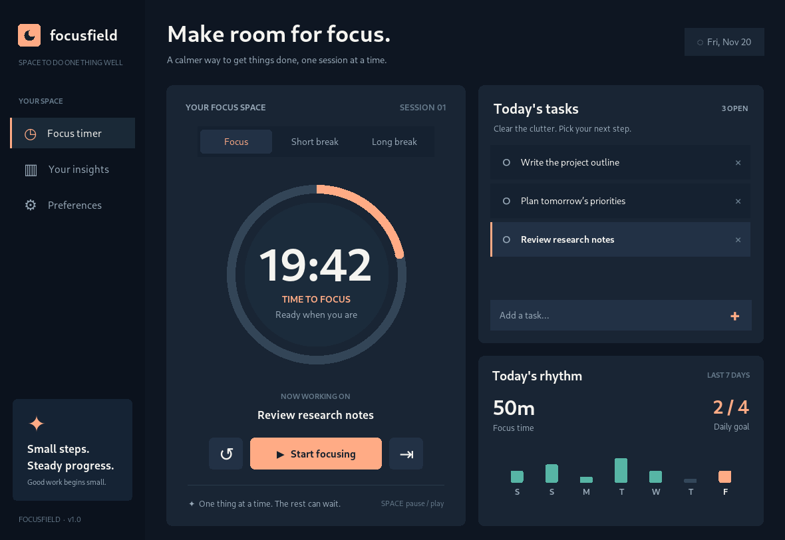

# Focusfield ✦

**A quiet place to do one thing well.** A modern, minimal Pomodoro timer that runs as a real desktop window on Linux.



## Features

- **Beautiful focus timer:** animated progress ring, pause/resume, reset, skip, and three timer modes.
- **Thoughtful cycles:** short breaks and a longer break after every fourth completed focus session (customizable).
- **Real tasks:** add tasks, choose which task you're working on, mark complete, or remove tasks.
- **Local statistics:** daily focus time, session goal, seven-day chart, session history, and lifetime totals.
- **Desktop integration:** Linux notifications on supported desktops, optional bell, launcher icon, optional always-on-top.
- **Easy to customize:** timer lengths, daily goal, auto-start behavior, notifications, sounds.
- **Private by default:** data is saved on your computer in a human-readable JSON file. No account or telemetry.
- **Works offline:** no internet is needed after installation.
- **Accurate clock:** timer uses monotonic time and keeps going when you minimize or switch windows.

## Downloads

Tagged GitHub releases provide:

- `focusfield_1.0.0_all.deb` — Debian, Ubuntu, Linux Mint, and compatible systems. Install with `sudo apt install ./focusfield_1.0.0_all.deb`.
- `Focusfield_Linux_Portable.zip` — portable package for Fedora, Arch, and other Linux distributions (requires Python and Tkinter).

## Quick start on Ubuntu, Fedora, Mint and other Linux distros

Focusfield uses **Python 3.9+** and the standard-library **Tkinter** GUI toolkit. It does not need pip or a virtual environment.

1. If Tkinter is not already installed, install it with your distro's package manager:

   - Ubuntu / Debian / Mint: `sudo apt install python3-tk`
   - Fedora: `sudo dnf install python3-tkinter`
   - Arch / Manjaro: `sudo pacman -S tk`

2. In this extracted folder, run:

   ```bash
   ./run.sh
   ```

3. To install an icon and launcher in your Linux application menu (for your user account, without sudo), run:

   ```bash
   ./install.sh
   ```

After installing, search your app menu for **Focusfield**, or run `~/.local/bin/focusfield`.

To uninstall the application (but preserve your personal timer data), run `./uninstall.sh` from the extracted folder.

## Everyday use

- Select **Focus**, **Short break**, or **Long break** at the top of the timer card.
- Press **Start focusing**. The ring gradually fills as your session progresses.
- Add tasks in the right column, then select a row to work on that task.
- Completion automatically records a focus session and prepares the appropriate break.
- Open **Your insights** to review your work; open **Preferences** to adjust your rhythm.

### Keyboard shortcuts

| Shortcut | Action |
| --- | --- |
| `Space` | Start or pause the timer (unless you're typing) |
| `Ctrl+N` | Jump to the task input |
| `Ctrl+R` | Reset the current timer |

## Local data

Focusfield stores tasks, settings, and completed sessions at:

`~/.local/share/focusfield/state.json`

On Linux configurations with `XDG_DATA_HOME` set, it uses `$XDG_DATA_HOME/focusfield/state.json` instead.

The timer **continues while the application is minimized**. If you close the app entirely, your remaining time is saved and restored as **paused** on the next launch (it does not silently complete sessions while fully closed).

Linux desktop notifications use `notify-send` from `libnotify` when available. On Ubuntu it is commonly available; otherwise the app still shows an in-window notification and can ring the system bell. Enable desktop notifications in your OS settings if they are suppressed.

## Troubleshooting

- `No module named tkinter`: install your distro's Tkinter package above.
- `no display name and no $DISPLAY`: launch from a running Linux graphical session rather than a headless terminal.
- Missing desktop notifications: install your distribution's `libnotify` tools (e.g., `sudo apt install libnotify-bin`) and check notifications are enabled.
- No app menu entry: log out and back in, or run `~/.local/bin/focusfield` directly.

## Development and tests

Run the standard-library unit tests:

```bash
python3 -m unittest discover -s tests -v
```

The application is fully offline and written in Python with Tkinter. No third-party packages or services are required at runtime.

## Building release packages

On a Linux system with `dpkg-deb` installed, run:

```bash
./scripts/build_release.sh
```

Both release assets and a `SHA256SUMS` checksum file will appear in `dist/`. Building only the ZIP is supported on Linux systems without `dpkg-deb`. The public-release workflow runs tests and builds both packages from a version tag.

See [CHANGELOG.md](CHANGELOG.md) for the release history.
